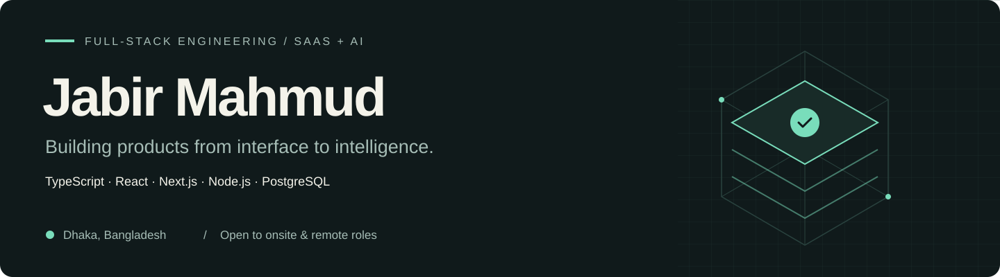
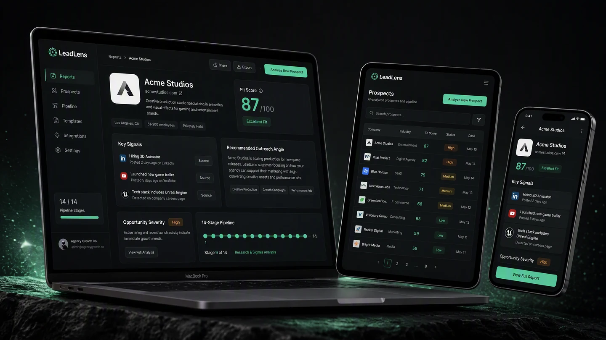
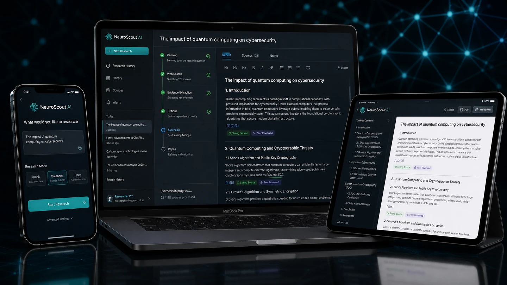
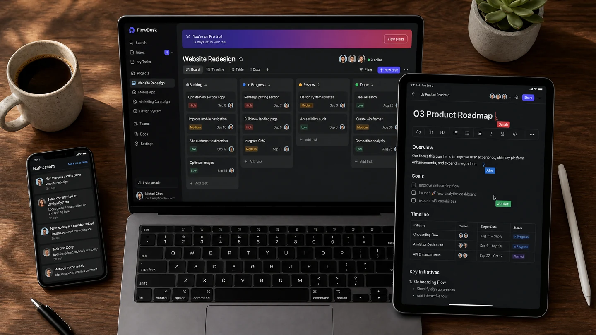
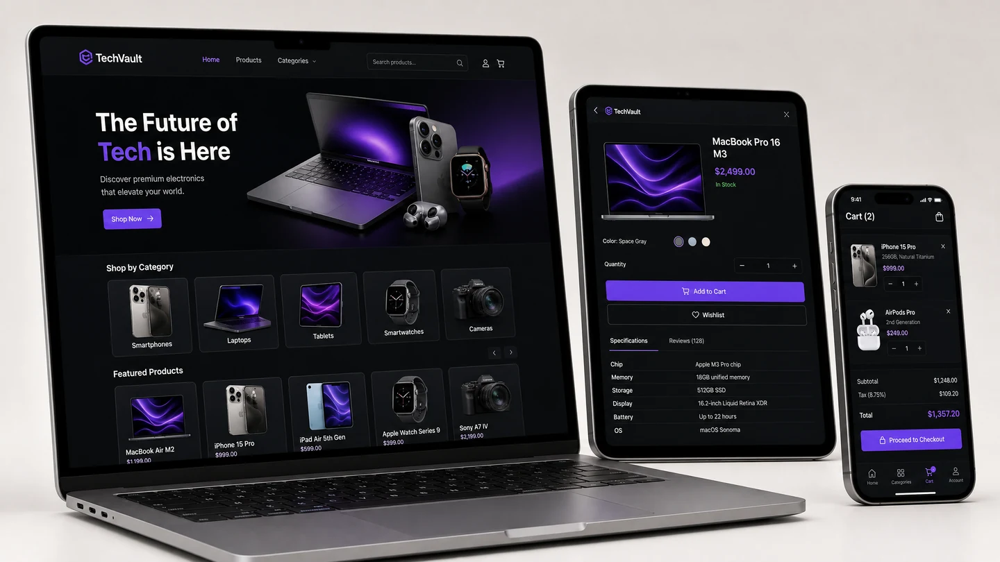
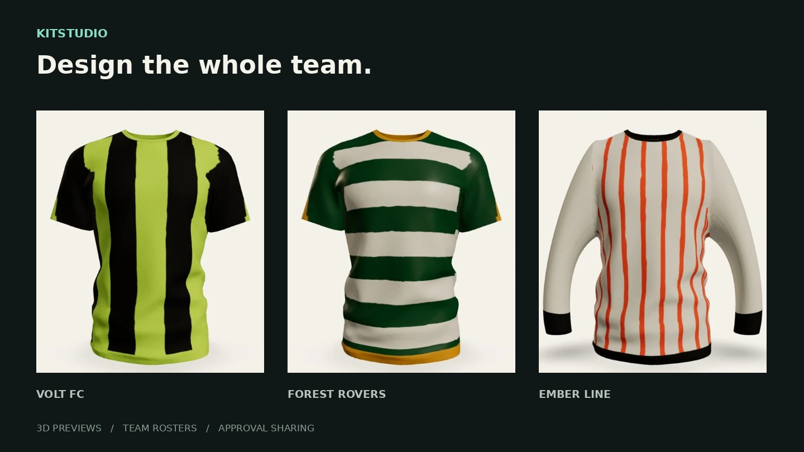

<picture>
  <source media="(prefers-color-scheme: dark)" srcset="assets/banner-dark.svg" />
  <source media="(prefers-color-scheme: light)" srcset="assets/banner-light.svg" />
  
</picture>

  <a href="https://jabir.pro.bd/"><strong>Portfolio</strong></a> &nbsp;·&nbsp;
  <a href="assets/Jabir_Mahmud_Software_Engineer_Resume.pdf"><strong>Résumé</strong></a> &nbsp;·&nbsp;
  <a href="https://www.linkedin.com/in/jabirmahmud0/"><strong>LinkedIn</strong></a> &nbsp;·&nbsp;
  <a href="mailto:jaabirmahmud01@gmail.com"><strong>Email</strong></a>

## Full-Stack Engineer specializing in SaaS and AI

I build web products end to end: interfaces, APIs, data models, real-time systems, and AI workflows. My work includes multi-tenant SaaS, prospect intelligence, commerce platforms, and interactive 3D tools.

Previously a **Junior Developer at Ainomiq**, working remotely with a Netherlands-based team. I also build and launch websites for freelance clients.

**Open to onsite roles in Bangladesh and remote roles with international teams.** Based in Dhaka · UTC+6.

## Experience

| Role | Work | Period |
| :--- | :--- | :--- |
| **Junior Developer · Ainomiq** | Remote, Netherlands · Next.js, React, TypeScript, AI integrations, and product workflows | Mar–Sep 2026 |
| **Freelance Web Developer** | Built and deployed web applications for clients worldwide | Jun 2024–present |

## Featured work

<table>
<tr>
<td width="50%" valign="top">

<h3>LeadLens</h3>

Evidence-backed prospect research, agency fit scoring, and outreach in one SaaS workflow.

Next.js · TypeScript · PostgreSQL · Gemini / Groq

<a href="https://leadlens.saevix.dev/">Live demo</a> · <a href="https://github.com/Jabirmahmud0/LeadLens">Source code</a>

</td>
<td width="50%" valign="top">

<h3>NexDokandar</h3>

Co-architected a multi-tenant POS and inventory platform for business operations.

React · Express · PostgreSQL · Socket.IO

<a href="https://nexdokandar.vercel.app/">Live product</a> · <a href="docs/case-studies/nexdokandar.md">Case study</a>

</td>
</tr>
<tr>
<td width="50%" valign="top">

<h3>NeuroScout AI</h3>

A research assistant that searches the web and streams structured reports with citations.

React · FastAPI · Python · Gemini

<a href="https://neuroscout-ai.vercel.app/">Live demo</a> · <a href="https://github.com/Jabirmahmud0/neuroscout_ai">Source code</a>

</td>
<td width="50%" valign="top">

<h3>FlowDesk</h3>

Workspace-scoped project management with Kanban, collaborative docs, and real-time updates.

Next.js · tRPC · PostgreSQL · Redis

<a href="https://flowdeskmanager.vercel.app/">Live demo</a> · <a href="https://github.com/Jabirmahmud0/FlowDesk">Source code</a>

</td>
</tr>
<tr>
<td width="50%" valign="top">

<h3>TechVault</h3>

An electronics marketplace with customer, seller, and admin workflows and Stripe checkout.

Next.js · Express · PostgreSQL · Stripe

<a href="https://gotechvault.vercel.app">Live demo</a> · <a href="https://github.com/Jabirmahmud0/techvault">Source code</a>

</td>
<td width="50%" valign="top">

<h3>KitStudio</h3>

A 3D jersey configurator with team rosters, quantity pricing, and shareable approval previews.

React · Three.js · Zustand · Vitest

<a href="https://kitstudio-six.vercel.app">Live demo</a> · <a href="https://github.com/Jabirmahmud0/KitStudio">Source code</a>

</td>
</tr>
</table>

**More frontend work:** [CanvasFlow](https://canvas-flow-gamma.vercel.app) — infinite canvas editor with undo/redo; **94 performance / 96 accessibility** in desktop Lighthouse. [Source code](https://github.com/Jabirmahmud0/canvasflow).

**LeadLens performance:** **100 desktop Lighthouse performance**.

## Engineering toolkit

| Area | Technologies |
| :--- | :--- |
| **Frontend** | TypeScript, JavaScript, React, Next.js, Tailwind CSS, TanStack Query, Zustand, Redux Toolkit |
| **Backend & data** | Node.js, Express, FastAPI, PostgreSQL, Drizzle ORM, Redis, MongoDB, pgvector |
| **AI systems** | RAG, Gemini, OpenAI API, Groq, structured outputs, background workers |
| **Product integrations** | Socket.IO, SSE, Stripe, JWT / OAuth, Three.js, React Three Fiber |
| **Delivery & quality** | Docker, GitHub Actions, Vercel, Render, Vitest, Playwright, Sentry |

<strong>Explore all 22 projects</strong> — SaaS, AI, frontend, and developer tools

Browse the [complete project catalogue](docs/PROJECTS.md) for previews, live links, source repositories, and project summaries.

- **SaaS & full-stack:** NexDokandar, FlowDesk, TechVault, CureBay, CollabNote, NextTalent, Comfort Inn, CozyFind.
- **AI applications:** LeadLens, NeuroScout AI, CareerByAI, DevKit.
- **Frontend & tools:** KitStudio, CanvasFlow, OrbitUI, TradeGrid, Get Hyped, GymHub, Portfolio Website, FolioXe, Neon Marketing, OrBexa.

## Education

**B.Sc. in Computer Science and Engineering** · Daffodil International University · Graduated December 2025.

## Let’s build something useful

For full-stack engineering roles, SaaS development, AI integrations, or freelance work: **[jaabirmahmud01@gmail.com](mailto:jaabirmahmud01@gmail.com)**.
