# Project catalogue

22 projects across SaaS, AI applications, frontend engineering, and developer tools. These previews reuse my portfolio artwork; KitStudio uses its repository’s jersey preset artwork.

[Back to profile](../README.md)

## SaaS and full-stack

### NexDokandar

A multi-tenant operations platform for retail, wholesale, pharmacy, hardware, and e-commerce businesses, with organization-scoped data, POS, inventory, subscriptions, payments, and real-time workflows.

**Stack:** React 18, Node.js, TypeScript, PostgreSQL, Socket.IO, Stripe, SSLCommerz

[Live demo](https://nexdokandar.vercel.app/) · [Case study](case-studies/nexdokandar.md)

### TechVault

A multi-role electronics marketplace with secure checkout, seller and admin dashboards, and a type-safe monorepo architecture.

**Stack:** Next.js 16, TypeScript, Express.js, PostgreSQL, Drizzle ORM, Stripe, Turborepo

[Live demo](https://gotechvault.vercel.app) · [Source](https://github.com/Jabirmahmud0/techvault)

### FlowDesk

A completed multi-workspace project management platform with Kanban workflows, collaborative documents, real-time updates, and subscription billing.

**Stack:** Next.js, TypeScript, tRPC, PostgreSQL, Drizzle ORM, Redis, Socket.IO, Stripe

[Live demo](https://flowdeskmanager.vercel.app/) · [Source](https://github.com/Jabirmahmud0/FlowDesk)

### CureBay

[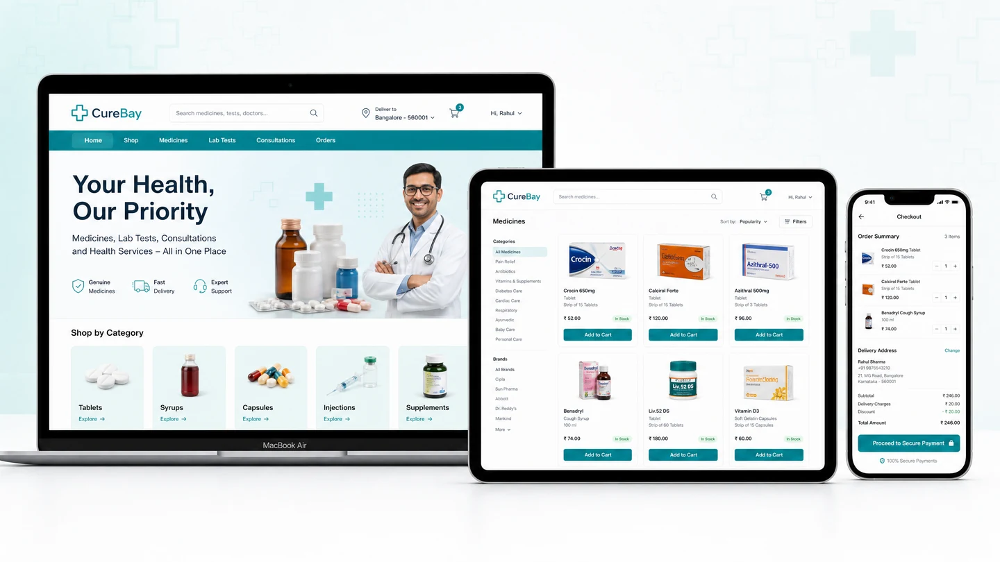](https://curebayy.vercel.app/)

A healthcare marketplace for medicines, lab tests, and consultations with Stripe payments and role-specific dashboards.

**Stack:** React, Vite, Tailwind CSS, Express, MongoDB, Stripe, Firebase

[Live demo](https://curebayy.vercel.app/) · [Source](https://github.com/Jabirmahmud0/CureBay_Client) · [Backend](https://github.com/Jabirmahmud0/CureBay_Backend)

### CollabNote

[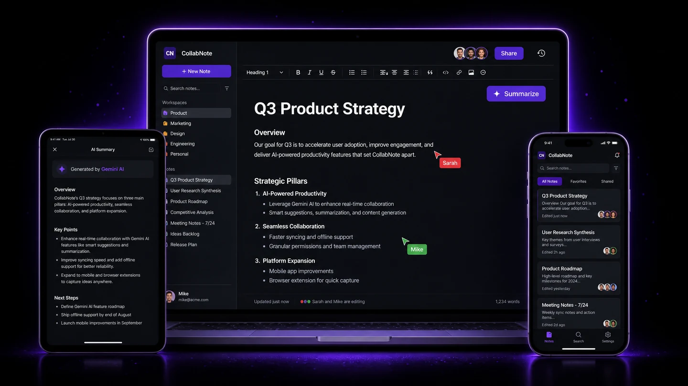](https://collabnote-six.vercel.app)

A real-time notes application with shared editing, presence, version history, and AI-assisted summaries.

**Stack:** React 19, Node.js, Socket.IO, MongoDB, Gemini AI, Quill.js, JWT

[Live demo](https://collabnote-six.vercel.app) · [Source](https://github.com/Jabirmahmud0/collabNote_client) · [Backend](https://github.com/Jabirmahmud0/collabNote_server)

### NextTalent

[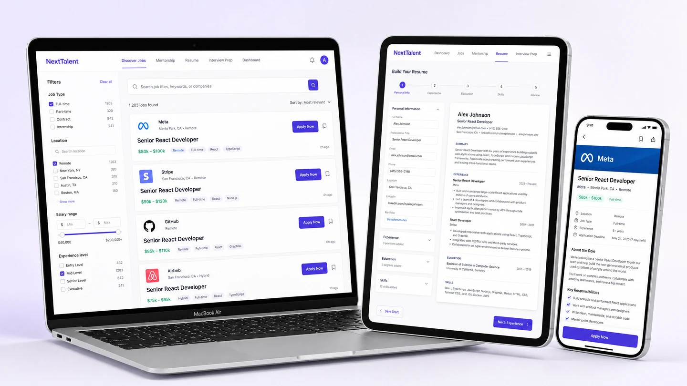](https://next-talent-client.vercel.app)

A responsive job platform with candidate search, saved opportunities, and Firebase-backed account workflows.

**Stack:** React, JavaScript, Tailwind CSS, Firebase

[Live demo](https://next-talent-client.vercel.app) · [Source](https://github.com/Jabirmahmud0/NextTalent_Client)

### Comfort Inn

A hotel-booking interface with maps, account dashboards, authentication, and responsive room discovery.

**Stack:** React, Vite, Tailwind CSS, Firebase, Leaflet

[Live demo](https://comfortin-five.vercel.app) · [Source](https://github.com/Jabirmahmud0/comfortin)

### CozyFind

[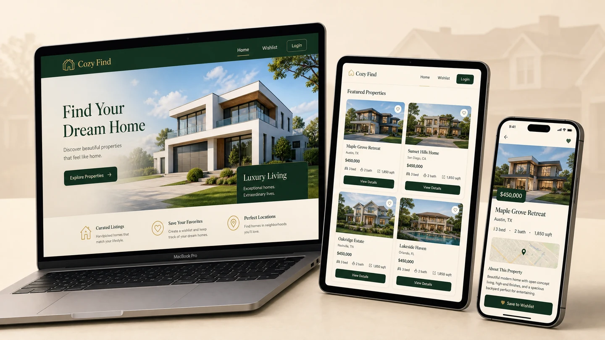](https://cozy-find.vercel.app/)

A property-discovery application with multi-parameter search, wishlists, authentication, and responsive listings.

**Stack:** React, Vite, Tailwind CSS, Firebase, React Router

[Live demo](https://cozy-find.vercel.app/) · [Source](https://github.com/Jabirmahmud0/CozyFind)

## AI applications

### LeadLens

A multi-tenant SaaS that turns a prospect's public website into an evidence-backed sales brief with fit scoring, opportunity analysis, and ready-to-use sales material.

**Stack:** Next.js 16, TypeScript, PostgreSQL, Drizzle ORM, Gemini, Groq, Stripe

[Live demo](https://leadlens.saevix.dev/) · [Source](https://github.com/Jabirmahmud0/LeadLens)

### NeuroScout AI

An autonomous research assistant that plans an investigation, searches the live web, extracts and critiques evidence, and streams a structured, cited report as it is assembled.

**Stack:** React 19, FastAPI, Python, Gemini, MongoDB, SSE, Beautiful Soup

[Live demo](https://neuroscout-ai.vercel.app/) · [Source](https://github.com/Jabirmahmud0/neuroscout_ai)

### CareerByAI

An AI-assisted career platform for personalized roadmaps, job matching, CV analysis, and curated learning resources.

**Stack:** React, Node.js, Express, MongoDB, Gemini AI, PDF.js

[Live demo](https://careerbyai.vercel.app/) · [Source](https://github.com/Jabirmahmud0/AI_career_Client) · [Backend](https://github.com/Jabirmahmud0/AI_career_Server)

### DevKit

[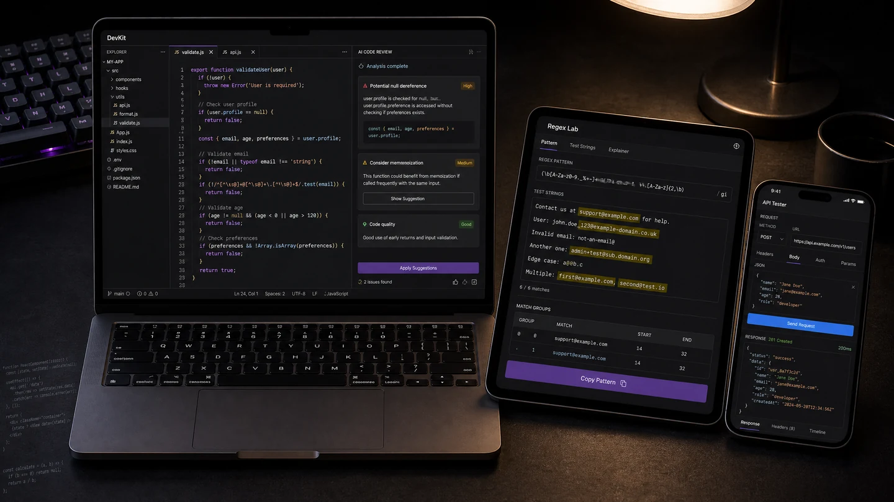](https://devkitai.vercel.app/)

A browser-based developer toolbox combining code review, SQL, regex, JSON, and API utilities in one workspace.

**Stack:** Next.js, TypeScript, Vercel AI SDK, Web Workers, Monaco Editor, Gemini AI

[Live demo](https://devkitai.vercel.app/) · [Source](https://github.com/Jabirmahmud0/DevKitAIPoweredDeveloperToolBox)

## Frontend and developer tools

### TradeGrid

A cryptocurrency dashboard with WebSocket market streams, Canvas-based charts, and order-book visualization.

**Stack:** React 19, TypeScript, Zustand, Canvas, WebSocket, Web Workers, D3

[Live demo](https://tradegrid-sand.vercel.app) · [Source](https://github.com/Jabirmahmud0/tradegrid)

### CanvasFlow

[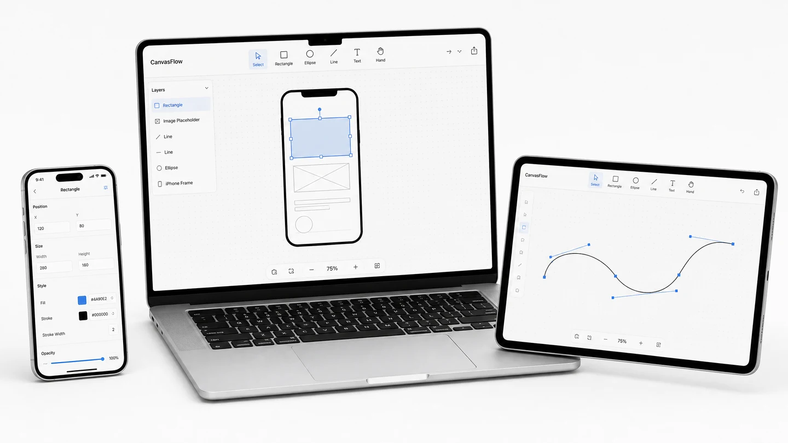](https://canvas-flow-gamma.vercel.app)

An infinite-canvas vector editor with selection tools, object manipulation, and automated browser testing.

**Stack:** React 19, Konva.js, Zustand, Vite 7, Framer Motion, Playwright

[Live demo](https://canvas-flow-gamma.vercel.app) · [Source](https://github.com/Jabirmahmud0/canvasflow)

### OrbitUI

[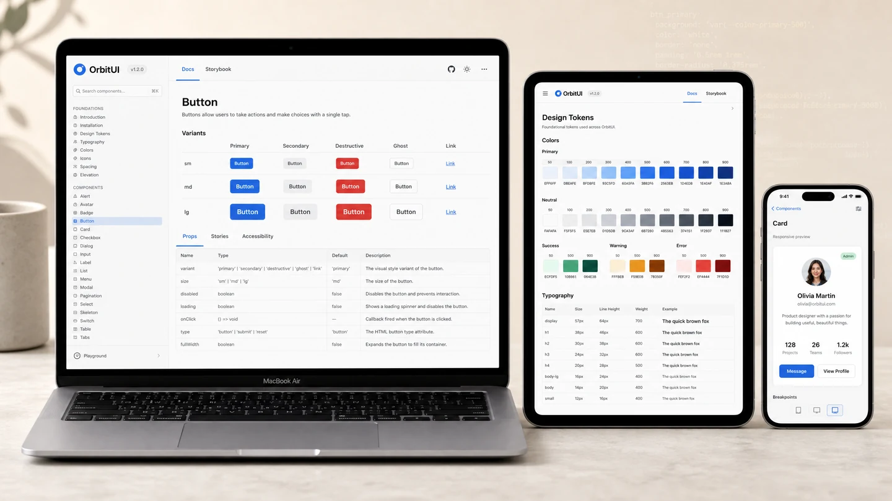](https://orbitui-storybook.vercel.app/?path=/docs/introduction--docs)

A reusable component library focused on accessible primitives, design tokens, theming, and package distribution.

**Stack:** React, TypeScript, Storybook, Vitest, Design Tokens, CI/CD

[Live demo](https://orbitui-storybook.vercel.app/?path=/docs/introduction--docs) · [Source](https://github.com/Jabirmahmud0/orbitui)

### Get Hyped

An interaction-focused marketing page with responsive motion, card compositions, and scrolling effects.

**Stack:** React 19, Vite, Tailwind CSS, Lenis, Framer Motion

[Live demo](https://gethyped-ecru.vercel.app/) · [Source](https://github.com/Jabirmahmud0/gethyped)

### GymHub

[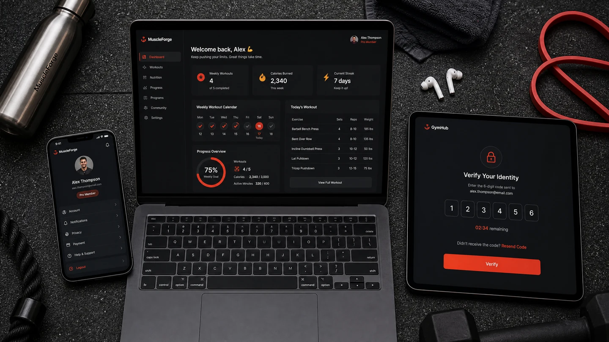](https://muscle-task.vercel.app)

A fitness dashboard with credential and OTP flows, responsive data views, and account-management interfaces.

**Stack:** React 19, Vite, Tailwind CSS, Framer Motion, React Hook Form, OTP Auth

[Live demo](https://muscle-task.vercel.app) · [Source](https://github.com/Jabirmahmud0/muscleTask)

### Portfolio Website

[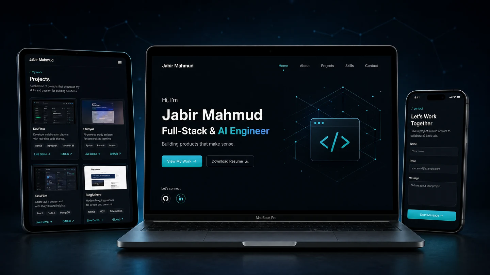](https://jabir.pro.bd/)

This responsive React portfolio, built to present selected work, project evidence, and contact information clearly.

**Stack:** React 19, Vite 7, JavaScript, Tailwind CSS, Framer Motion

[Live demo](https://jabir.pro.bd/) · [Source](https://github.com/Jabirmahmud0/portfolio_xabir)

### FolioXe

A lightweight personal portfolio application with Firebase-backed content and a responsive React interface.

**Stack:** React, Firebase, Tailwind CSS

[Live demo](https://folioxe.vercel.app) · [Source](https://github.com/Jabirmahmud0/folioxe)

### Neon Marketing

[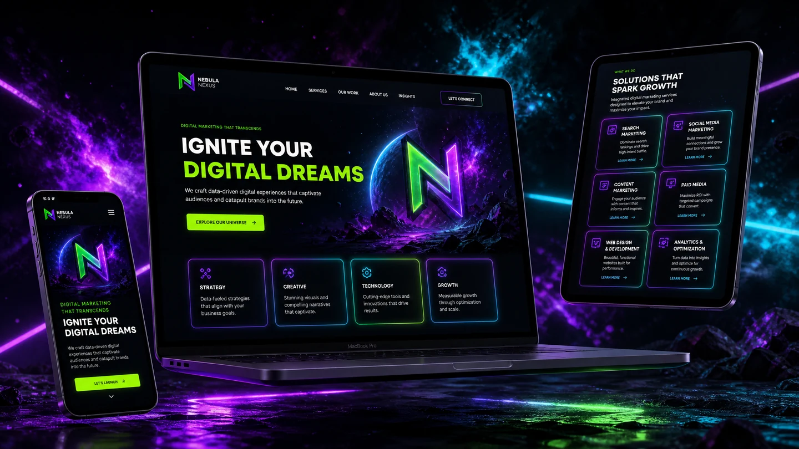](https://nebula-marketing.vercel.app/)

A responsive static marketing experiment using layered CSS effects, parallax behavior, and lightweight interactions.

**Stack:** HTML5, CSS3, JavaScript, jQuery

[Live demo](https://nebula-marketing.vercel.app/) · [Source](https://github.com/Jabirmahmud0/Nebula_Marketing)

### OrBexa

[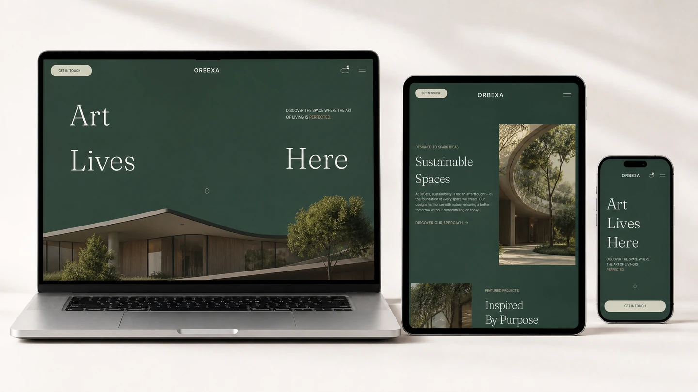](https://orbexaecommerce.vercel.app)

A static storefront concept with product interactions, responsive layouts, and on-demand Lottie animation.

**Stack:** HTML5, CSS3, JavaScript, Lottie

[Live demo](https://orbexaecommerce.vercel.app) · [Source](https://github.com/Jabirmahmud0/OrBexa_ECommerce)

### KitStudio

A 3D team jersey configurator with player personalization, roster management, shareable approval previews, and export workflows.

**Stack:** React, TypeScript, Three.js, React Three Fiber, Zustand, Vitest

[Live demo](https://kitstudio-six.vercel.app) · [Source](https://github.com/Jabirmahmud0/KitStudio)
