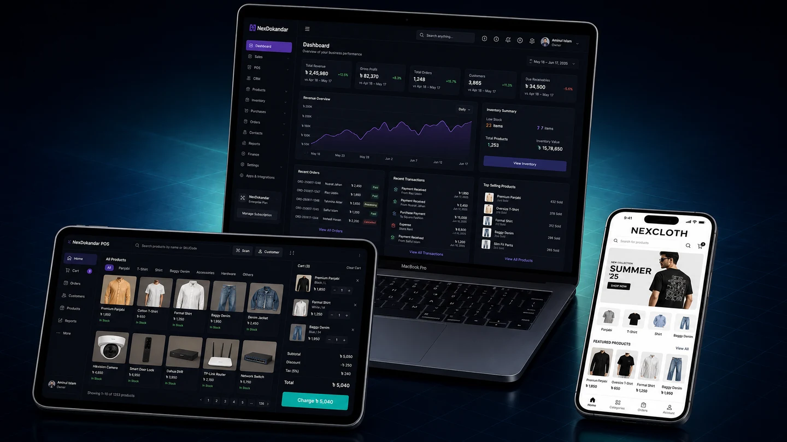
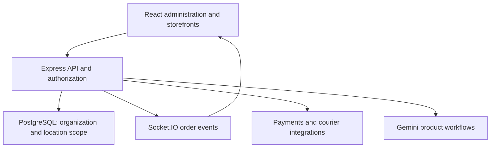

# NexDokandar

**Multi-tenant commerce, inventory, and POS operations.**

[Main SaaS](https://nexdokandar.vercel.app/) · [Clothing tenant](https://nex-cloth.vercel.app/) · [Hardware tenant](https://nex-hardware.vercel.app/) · [Pharmacy tenant](https://nex-pharm-pi.vercel.app/)

## The problem

Retail, wholesale, pharmacy, hardware, and e-commerce businesses need different catalog and operational workflows. A shared platform needs to support those differences while keeping each organization’s users, inventory, orders, finances, and subscription state separate.

## My contribution

I co-architected the platform on Express v5 and PostgreSQL and implemented real-time order updates, JWT-based role permissions, and protected routes across more than 30 modular UI views. I built APIs for partial refunds, due calculations, and serialized-product tracking, along with API key and webhook token systems for courier integrations.

I also built Gemini-powered bundle recommendations with inventory liquidation strategies and duplicate prevention through PostgreSQL cross-referencing. A prompt-to-product workflow generates product titles, SKUs, pricing, and descriptions.

## Architecture

Organization and location boundaries scope users, catalog, inventory, registers, and staff. The backend owns tenant authorization, plan limits, payment handling, and business rules; interface guards support the user experience.

## Selected capabilities

- Retail and wholesale POS, variants, barcodes, serial tracking, returns, and invoices.
- Organization and location isolation across business records and operational reports.
- Subscription plans, feature gates, resource limits, and payment workflows.
- Real-time order events and operational notifications.
- AI product generation and bundle recommendations.

## Outcome

Real-time order updates improved operational efficiency by **30%**.

## Stack and access

React 18, TypeScript, Redux Toolkit, Tailwind CSS, Node.js, Express v5, PostgreSQL, Socket.IO, JWT, Stripe, Cloudinary, and Gemini API.

Source repositories are private. The public product and storefront deployments provide a view of the application; implementation details can be discussed in an interview where appropriate.

[Back to project catalogue](../PROJECTS.md) · [Contact Jabir](mailto:jaabirmahmud01@gmail.com)
